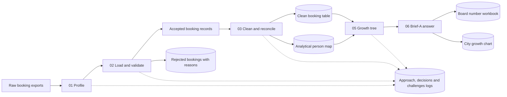
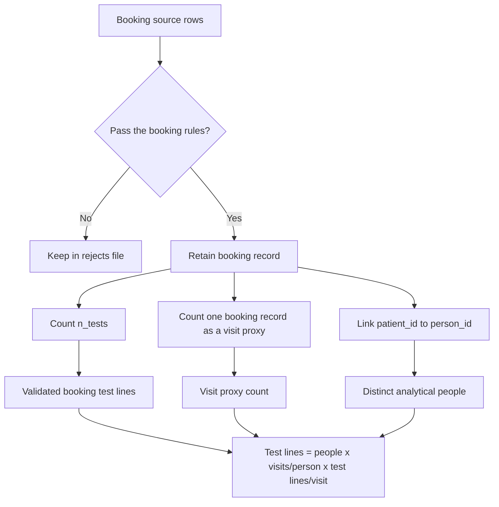
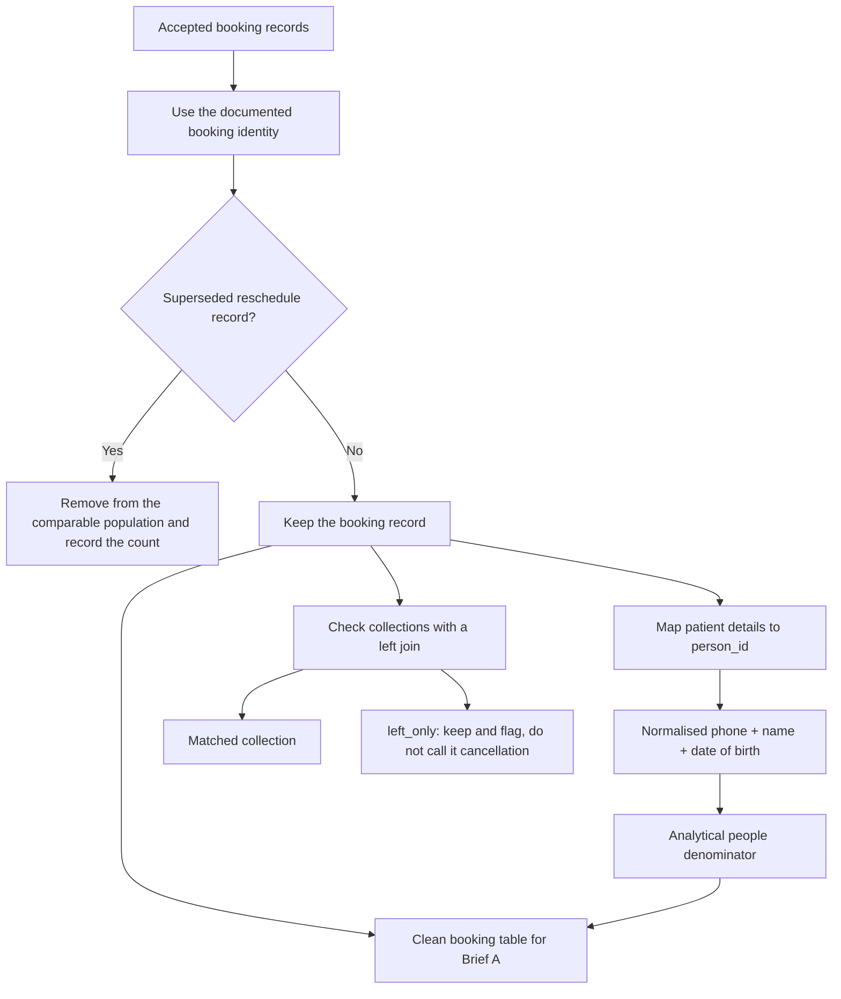
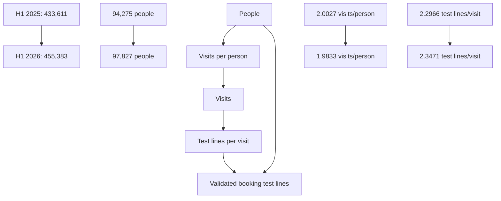
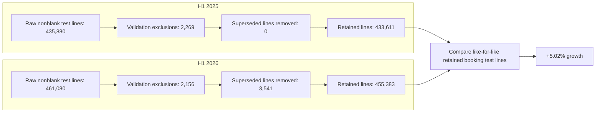
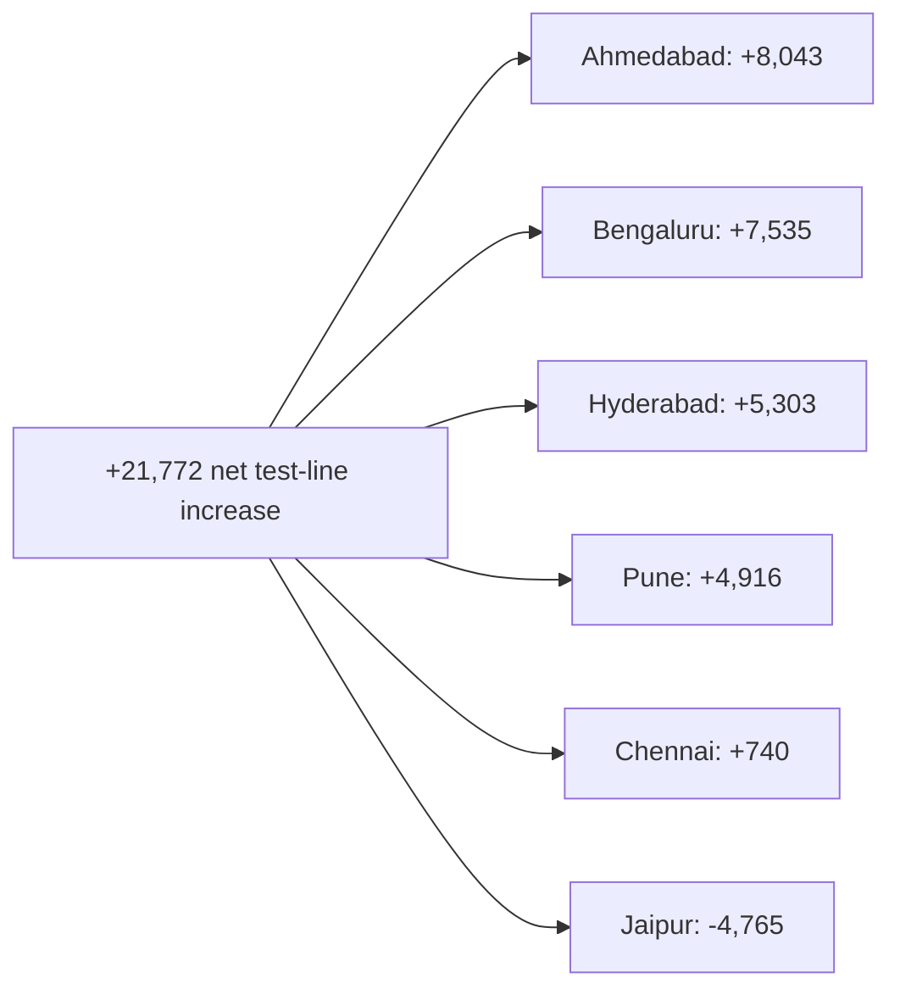
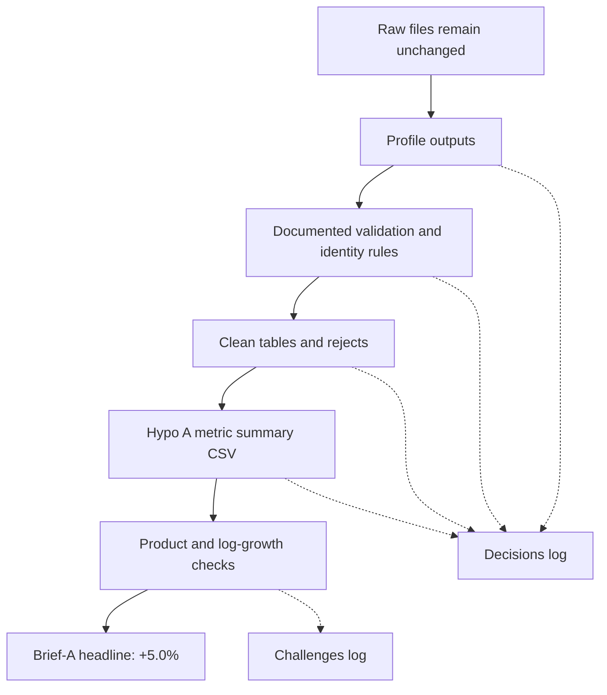

# Brief A diagrams

These diagrams describe the selected Brief-A analysis: explaining the change in
validated booking test lines between H1 2025 and H1 2026.

## 1. Brief-A analysis in one view

## 2. What is counted for Brief A

The result is a booking-line measure. It is not a claim that every line was
attended, collected or performed.

## 3. Cleaning and identity decisions

The person key is suitable for aggregate growth analysis. It is not a verified
clinical identity and should not be used for result routing.

## 4. Brief-A growth tree

The measured changes are:

- Total test lines: **+5.02%**
- People: **+3.77%**
- Visits per person: **-0.97%**
- Test lines per visit: **+2.20%**

The three factor changes multiply back to the total change. Their logarithmic
changes also add up to the total logarithmic change.

## 5. H1 comparison and reconciliation

The periods use the complete local calendar half-years:
`[2025-01-01, 2025-07-01)` and `[2026-01-01, 2026-07-01)`.

## 6. City contribution to the Brief-A result

The city view describes where the change appeared. It does not prove why the
change happened. The source city fields remain unchanged; the documented
`Bangalore` to `Bengaluru` mapping is used only for the comparable city view.

## 7. Evidence and audit trail

The main evidence files are:

- `data/hypo_A/brief_a_iitgn_metric_summary.csv`
- `data/hypo_A/brief_a_iitgn_component_changes.csv`
- `data/hypo_A/brief_a_iitgn_city_contributions.csv`
- `data/hypo_A/brief_a_iitgn_reconciliation.csv`
- `docs/brief-a-iitgn-aligned-results.md`
